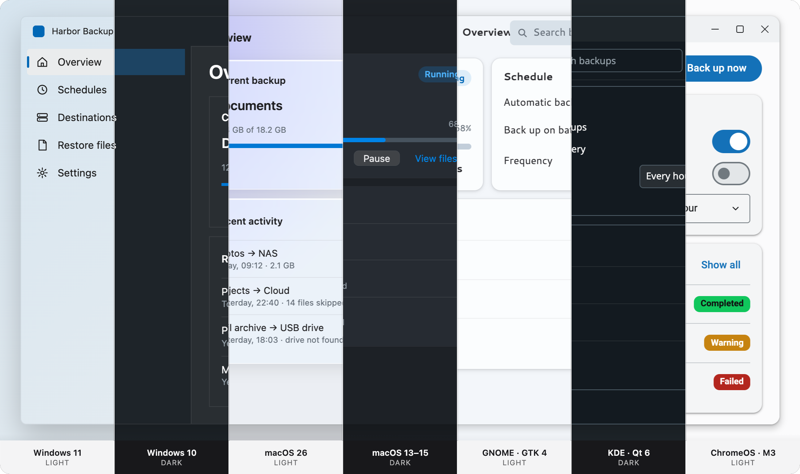
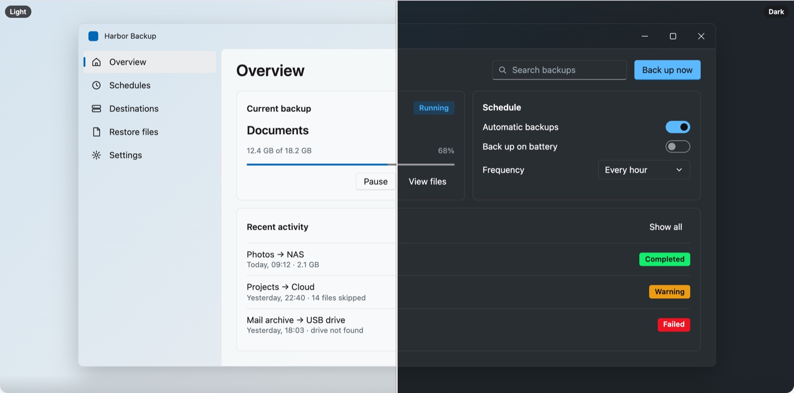
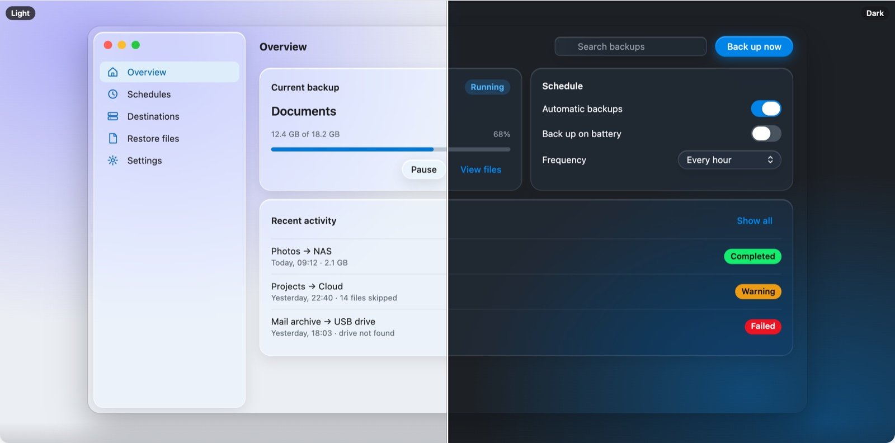

# Harbor Backup

[](https://github.com/Spartan-Native/harbor/actions/workflows/ci.yml) [](https://spartan-native.github.io/harbor/) [](LICENSE)

The sample app for [Spartan Native](https://github.com/Spartan-Native/spartan-native): one Angular codebase that looks native on Windows 11, Windows 10, macOS 26, macOS 13–15, GNOME, KDE and ChromeOS, in the browser and as a desktop app.

**[Try the live demo](https://spartan-native.github.io/harbor/demo/)** · [Website](https://spartan-native.github.io/harbor/) · [Spartan Native](https://spartan-native.github.io/spartan-native/) · [The spec](docs/sample-app.md)



Harbor is the end-to-end acceptance test for the Spartan Native packages and host adapters: it must run with `@spartan-native/host-web` in the browser and with `@spartan-native/host-wails` in Wails, with no UI code changes. The spec (pages, components, acceptance criteria) is in [`docs/sample-app.md`](docs/sample-app.md).

> Status: **the main window and every page work** on Windows 11, macOS 26 and GNOME, built from stock spartan/ui components and the Spartan Native packages. In the browser it runs on `webHost()`: the browser's accent, light/dark, contrast, transparency, text size and window focus flow in live. As a Wails app it reads the real OS settings through the host-wails Go service. The dev bar shows what the OS reports and can override the skin and scheme ("Follow system" drops the overrides).

## Repository layout

```text
.
├── app/                    The Angular app
│   ├── src/                Window, pages (src/app/harbor/pages), data store, PWA helpers
│   ├── public/             Manifest and icons
│   ├── .storybook/         Storybook with the Spartan Native toolbar, text size and window focus
│   └── e2e/                Visual test: every page on every skin, light and dark
├── components/ui/          Stock spartan/ui helm components (@spartan-ng/helm/*)
├── desktop/
│   └── wails/              Wails v3 shell (Go)
├── docs/                   The spec and images
├── site/                   The project page, published to GitHub Pages with the live demo
├── scripts/                build-site.mjs: the page (and demo) into dist/site
├── angular.json, package.json, tsconfig.json
└── playwright.config.ts
```

## Setup

Node ≥ 24.15 (see `.nvmrc`), npm ≥ 11. The `@spartan-native/*` packages come from npmjs.org, so no token or registry setup is needed:

```bash
npm install
```

## Run in the browser

```bash
npm start                 # ng serve harbor-backup → http://localhost:4200
npm run build             # → dist/harbor-backup/browser
npm test                  # unit tests
npm run storybook         # Storybook on port 6010
```

| File | What it is |
| --- | --- |
| `app/src/app/harbor/harbor-window.*` | The window: sidebar, header, pages, per-OS window chrome |
| `app/src/app/harbor/pages/` | One component per menu point, sharing `HarborStore` (`data/harbor-store.ts`) |
| `app/src/app/app.ts` | Wallpaper stage + dev bar (system readout, overrides) |
| `app/src/app/app.config.ts` | `provideSpartanNative({ host: isWails() ? wailsHost() : webHost() })` |





### Install as an app (PWA)

Harbor is an installable Progressive Web App: a manifest with its own icon set (including maskable icons), and a service worker for offline use in production builds.

1. `npm start` and open http://localhost:4200 in Chrome or Edge.
2. Click **Install** in the address bar (or ⋮ → *Cast, save and share* → *Install page as app*).

| Running as | Frame | What Harbor draws |
| --- | --- | --- |
| Browser tab | the browser's | the full mock window on a wallpaper (a demo of the skins) |
| Installed | the OS title bar | no chrome of its own; it fills the window |
| Installed, title bar overlay (`display_override: window-controls-overlay`) | the OS draws only the window buttons | its own title bar in the `env(titlebar-area-*)` area, as a drag region |

In an installed window, toggle the title-bar overlay from the app's title-bar menu (the chevron next to the window buttons). Harbor follows the change live: `watchDisplayMode()` from `@spartan-native/host-web` drives the `frame` input of `HarborWindow`.

**Why install:** Chromium hides the OS accent from regular tabs (it answers a fixed blue), but installed apps can receive the real one. Once it does, the dev bar stops saying "accent hidden by this browser" and the theme follows your system accent.

**Service worker:** it is registered in production builds only (`npm run build`; serve `dist/harbor-backup/browser` from any static server on localhost or HTTPS). Chrome doesn't need it to install the app, so the dev server installs fine too.

| File | What it is |
| --- | --- |
| `app/public/manifest.webmanifest` | Name, colors, `display_override`, icons |
| `app/public/icons/` | `icon.svg` (source), PNGs 72–512, maskable 192/512, Apple touch icon, favicon |
| `app/ngsw-config.json` | Service worker caching (Angular) |
| `app/src/app/pwa/window-mode.ts` | `injectDisplayMode()`: browser tab / installed / overlay as a signal |

## Run as a desktop app

| Shell | Folder | Run | Status |
| --- | --- | --- | --- |
| Wails v3 (Go) | [`desktop/wails`](desktop/wails/README.md) | `npm run start:desktop:wails` | Works on macOS; Windows and Linux build |
| Tauri, Electron, .NET (Photino) | | | Planned, once their host adapters exist |

```bash
npm run start:desktop:wails    # build the app, embed it, build and run the binary
npm run build:desktop:wails    # build only → desktop/wails/bin/harbor-backup[.exe]
```

The Wails shell needs Go ≥ 1.26 and the Wails v3 platform prerequisites; the Go module `github.com/spartan-native/host-wails` comes from the public Go proxy. See [`desktop/wails/README.md`](desktop/wails/README.md), including the rule that the Go module and `@spartan-native/host-wails` stay at the same version.

### Adding another shell

Each desktop shell is its own folder under `desktop/`, next to `wails/`. A shell:

1. Builds the Angular app (`ng build harbor-backup`, output `dist/harbor-backup/browser`) and loads it in its webview. Copy `desktop/wails/scripts/build.mjs` as a start: it resolves the repository root from its own folder.
2. Registers the native side of its host adapter (`@spartan-native/host-<runtime>`).
3. Gets a host branch in `app/src/app/app.config.ts` (e.g. `isTauri() ? tauriHost() : …`); the UI code doesn't change.
4. Gets `build:desktop:<shell>` and `start:desktop:<shell>` scripts in `package.json`, a CI job in `.github/workflows/ci.yml`, and a row in the table above.

## Visual test

`app/e2e/pages.spec.ts` screenshots every page on all seven skins, light and dark, from the built Storybook. It is slow, and the baselines (`app/e2e/__screenshots__/<platform>/`) are per machine and not committed, so it isn't part of CI.

```bash
npm run test:visual                          # build Storybook, then compare
npm run test:visual -- --update-snapshots    # accept the new look
npm run test:report                          # open the last report
```

## Dependencies

| Package | Used for |
| --- | --- |
| `@spartan-native/theme` | Tokens, skins, `provideSpartanNative()`, the Storybook toolbar |
| `@spartan-native/helm` | Desktop behaviours for the helm components (selection, default/cancel buttons) |
| `@spartan-native/desktop-ui` | Window chrome, OS patterns, settings groups, modal sheets, inspector, command bar |
| `@spartan-native/host-web` | The browser / PWA host |
| `@spartan-native/host-wails` | The Wails host (with the Go module `github.com/spartan-native/host-wails`) |
| `@spartan-ng/brain` + `components/ui` | spartan/ui |
| `@tanstack/angular-charts`, `ngx-scrollbar`, `@ng-icons/lucide` | Backup-size chart, scroll areas, icons |

## Website

[`site/`](site/index.html) is the project page, in the style of the other Spartan Native pages. On every push to `main`, [`pages.yml`](.github/workflows/pages.yml) builds it together with the app (base href `/harbor/demo/`) and deploys both to <https://spartan-native.github.io/harbor/>.

```bash
npm run build:site          # the page only → dist/site (npx serve dist/site)
npm run build:site:demo     # the page and the demo, as GitHub Pages serves them
```

## Contributing

See [CONTRIBUTING.md](CONTRIBUTING.md). Problems in a component, skin or host adapter belong to [spartan-native](https://github.com/Spartan-Native/spartan-native) or [host-wails](https://github.com/Spartan-Native/host-wails); Harbor shows those packages as they are. Changes are listed in [CHANGELOG.md](CHANGELOG.md).

## License

[MIT](LICENSE). The stock spartan/ui components in `components/ui/` are MIT licensed by their authors; see [NOTICE](NOTICE). Harbor Backup is a fictional product, and platform names are trademarks of their respective owners.
